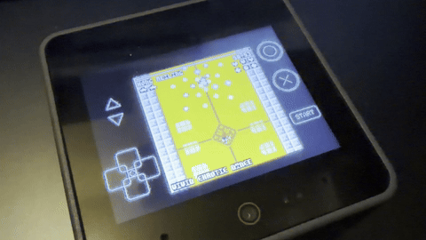

# RONTO8 for M5Stack CoreS3 (v0.61)



RONTO8 is an experimental [PICO-8](https://www.lexaloffle.com/pico-8.php) compatible fantasy console emulator specially designed and optimized for the [**M5Stack CoreS3**](https://docs.m5stack.com/ja/core/CoreS3). It is based on [femto8](https://github.com/benbaker76/femto8) and [zepto8](https://github.com/samhocevar/zepto8), bringing the joy of portable PICO-8 gaming and coding to this powerful device.

RONTO8は、[**M5Stack CoreS3**](https://docs.m5stack.com/ja/core/CoreS3) 専用に設計および最適化された [PICO-8](https://www.lexaloffle.com/pico-8.php) 互換のファンタジーコンソールエミュレータ（実験バージョン）です。[femto8](https://github.com/benbaker76/femto8) と [zepto8](https://github.com/samhocevar/zepto8) をベースにしており、このパワフルなデバイスでPICO-8のゲームやコーディングの楽しさを持ち歩くことができます。

---

## ⚠️ Disclaimer / 注意事項

- **Experimental Release / 実験的なリリース**: This is highly experimental code. If you find bugs, please report them gently! (実験的なコードであるため、バグを見つけた場合は優しく教えてください！)
- **Memory Limitations / メモリ制限**: Due to the hardware limitations, some very large PICO-8 cartridges may not work or may cause "not enough memory" errors during Lua compilation. (ハードウェア制限により、非常に大きいカートリッジは動作しないか、コンパイル時にメモリ不足エラーになる場合があります。)

---

## 🌟 Key Features / 主な機能

- **Optimized for M5Stack CoreS3**: Full support for the CoreS3's display and touch screen as a virtual gamepad.
  - CoreS3のディスプレイとタッチスクリーン（仮想ゲームパッド）に完全対応。
- **SD Card ROM Browser**: Load `.p8.png` or `.p8` cartridges directly from the SD card.
  - SDカードから `.p8.png` や `.p8` 形式のカートリッジを直接ロード可能。
- **Audio Support**: Enhanced audio synthesis for authentic PICO-8 SFX and Music playback.
  - PICO-8特有の効果音（SFX）やBGMを再現するオーディオエンジンを搭載。

## 🎮 Controls / 操作方法

- **Touch Screen / タッチスクリーン**: A virtual gamepad is displayed on the screen. (画面上に仮想コントローラーが表示されます)
  - **D-Pad / 方向キー**: Left side of the screen (画面左側)
  - **Button O**: Top right (画面右上). Hold for 1 second to lock the button state. (1秒長押しでボタンが押された状態にロックされます)
  - **Button X**: Bottom right (画面右下). Hold for 1 second to lock the button state. (1秒長押しでボタンが押された状態にロックされます)
  - **Start / Pause**: Bottom center (画面下部中央)
  - **Volume**: Left edge volume buttons (画面左端のボリュームボタン)

## 🎮 Faces Gamepad3 (development branch) / 物理ゲームパッド対応（開発版）

M5Stack **CoreS3 + Faces Bottom3 (A168) + Faces Gamepad3 (A004-V3)** are supported by the development branch.
Gamepad3 is detected automatically through the M5-Bus I2C connection (SDA=GPIO12, SCL=GPIO11, IRQ=GPIO10, I2C address 0x08, Gamepad model ID 0x03).
The driver reads the controls without rewriting the Gamepad3 firmware or configuration.

- **Detected:** physical Gamepad3 mode; 320×240 fullscreen on the CoreS3 LCD, with no on-screen controls or black bars. This fills the 4:3 screen by stretching PICO-8's original square image (non-square pixels).
- **Not detected:** original on-screen touch gamepad and 192×192 rendering.
- **Keys:** D-pad = movement / ROM browser; A = O / confirm; B = X / back; START = PICO-8 pause / confirm; **SELECT = RONTO8 settings (volume / restart game)**.
- **Stability:** IRQ-driven 1-byte direct key reads, periodic I2C model-ID probes, multiple failed probes required before disconnecting.
- ROM browser is full-width in Gamepad3 mode; the header says PAD READY (or TOUCH when no Gamepad3 is found).
- Touching the splash screen always works as a fallback, even when the Gamepad3 is detected.

### ⚠️ Faces Bottom3 LED IO switch / LED切替スイッチについて

**Power off before changing the switch. Set the Faces Bottom3's LED IO switch to `G25`, not `G15`.**
The Faces Bottom3 schematic connects its SK6812 chain to selectable G15/G25 M-Bus signals. On CoreS3:
- Bottom3 **G15** lands on CoreS3 **GPIO13**, used by the internal I2S speaker output. Audio may cause unwanted bright white RGB LED illumination.
- Bottom3 **G25** lands on CoreS3 **GPIO5**, which this development firmware initializes with an all-off SK6812 frame (10 LEDs) at boot.

**切替前に電源を切り、Faces Bottom3のLED IOを`G25`側へ変更してください。** G15側はCoreS3のスピーカー出力と重なるため、音声によってLEDが異常点灯する可能性があります。G25側では起動時に10個のLEDを消灯します。

CoreS3 + Faces Bottom3 + Gamepad3を自動認識し、ゲーム画面を320×240の液晶全面に表示します。PICO-8の正方形画面を4:3に引き伸ばすため縦横比は変わります。未接続時は従来のタッチ操作です。

**Status / 状態:** Initial APP-only build and factory-slot flashing succeeded on a CoreS3 on 2026-11-09. This follow-up display/input/LED revision has not yet been rebuilt or physically verified. Existing M5Burner releases and main are unchanged.
**初回開発版のビルド・factory APPのみの書き込みは実機で成功済み。今回の改訂版は未ビルド・実機未確認です。公開版とmainは未変更です。**

### Safe Windows APP-only firmware update / Windows書き込み

From the previously provided R3 ZIP folder:
```bat
RUN_THIS_R8CORES3_FACES_APP_ONLY.cmd COM10
```
The script updates this development branch, builds, reads and verifies the installed partition table, and flashes only the selected APP slot. Do not use a generic `pio run --target upload` command if protecting existing NVS/storage and partition table is necessary.

### Official-driver update (R4) / 公式ドライバ対応

The R4 development build follows the official M5Stack CoreS3 Gamepad3 Arduino example:
- `cfg.fallback_board = m5::board_t::board_M5StackCoreS3`
- `M5.In_I2C` initialized with `M5.getPin(in_i2c_sda / in_i2c_scl)` if needed
- `M5Faces_Gamepad3.begin(&M5.In_I2C)`, `update()`, and model-ID verification
- A user-visible **R4 PAD** or **R4 TOUCH** in the browser header, and **R4 GAMEPAD READY** or **R4 NO GAMEPAD** on the splash

The preceding hand-written key reader is no longer used. Official M5Faces is pinned by commit SHA. The physical keypad must be fully seated in Faces Bottom3. No automatic firmware update/IAP is performed on Gamepad3.

**R4はM5Stack公式Gamepad3ドライバを採用。** 画面の「R4 PAD / R4 TOUCH」で新しいファームウェアの起動と検出状態を区別できます。Gamepad3の内蔵ファームウェアは変更しません。

**Verification:** R4 source was updated; R4 build / on-device recognition remains to be confirmed. The previous build and APP-only flash did succeed.

### R5: physical detection and key protocol / Gamepad3認識R5

R5 replaces the generic "NO GAMEPAD" with a readable reason on the ROM browser and boot screen:

- **R5 PAD / R5 GAMEPAD READY**: Gamepad3 recognized; 320x240 fullscreen with physical controls.
- **R5 NO GAMEPAD + 0x08 NO ACK**: the controller is not responding at its default I2C address; with power disconnected, check that the 22-pin Gamepad3 panel is fully seated in Faces Bottom3 and that Bottom3 is fully mated to the CoreS3 M5-Bus.
- **R5 NO GAMEPAD + 0x08 BAD ID**: 0x08 responds, but the returned model ID/protocol is not the expected Gamepad3.
- **R5 NO GAMEPAD + I2C BUS FAIL**: the internal I2C bus could not be initialized.
- The driver can also recognize a Gamepad3 that responds to an older direct-key protocol at 0x08, and slowly scans for a valid Gamepad3 model ID at a non-default I2C address.

According to the M5Stack A004-V3 I2C specification, **key reads are direct single-byte I2C reads**, with no register address prefix; register reads such as 0xD0 are only used for device identification. R5 now follows that published behavior. No IAP, firmware update or peripheral configuration writes occur.

**R5では「NO GAMEPAD」だけでなく、通信応答なし（0x08 NO ACK）、ID不一致（0x08 BAD ID）、内部I2C初期化失敗（I2C BUS FAIL）を大きな文字で表示します。** 通信応答がない場合は、電源を落として22ピンのゲームパッドとCoreS3/BOTTOM3の差し込みを確認してください。認識すれば自動的に320×240全面表示になります。

**Status:** R5 code-only revision, build/device verification pending. Use the existing Windows R3 safe APP-only command: `RUN_THIS_R8CORES3_FACES_APP_ONLY.cmd COM10`. **Do not write bootloader/partition/NVS/storage.**

### R6 — Gamepad3 ready but buttons unresponsive / 認識後のキー入力修正

With R5, a recognized Gamepad3 could show **GAMEPAD READY** while no buttons reached RONTO8 because key reads were gated on `digitalRead(GPIO10) == LOW`. The official CoreS3 Gamepad3 sample instead repeatedly calls `M5Faces_Gamepad3::update()` without configuring the IRQ pin.

R6 removes that gate for official Gamepad3 firmware and uses the official driver's polling on every input tick. When IRQ actually signals an unread event but the official update sees no state change, a direct one-byte I2C read remains as a fallback. Legacy firmware retains a bounded direct-read path.

The ROM browser header now shows **R6 PAD**, then **R6 UP / R6 DOWN / R6 LEFT / R6 RIGHT / R6 A / R6 B / R6 START** while a physical button is pressed. The display remains full 320×240 when the panel is detected.

**「GAMEPAD READY」なのに操作できない問題:** R5のIRQレベル依存を修正し、公式ドライバによるキー取得を毎回実行します。ROM一覧上部には入力中の物理ボタンを大きな文字で表示します。既存のR3 APP-onlyコマンド `RUN_THIS_R8CORES3_FACES_APP_ONLY.cmd COM10` で更新可能です。

**State:** GitHub source updated, static checks passed. R6 firmware build and physical verification are pending. The release branch, M5Burner build, bootloader, partitions, NVS and storage are not changed.

### R8 — SELECT settings menu with RESET CORE / SELECT設定メニュー

CoreS3 + Faces Bottom3 + Gamepad3 users can open the RONTO8 settings with **SELECT**. The confirmed-working R6 gamepad input and 320×240 fullscreen are retained.

**When a game is running, menu order:**
1. **CONTINUE** — return to the game
2. **RESET GAME** — reload the current SD cartridge/Lua game state without rebooting the CoreS3
3. **RESET CORE** — perform an intentional software restart of the **CoreS3 MCU** via `ESP.restart()`; the device starts RONTO8 from its normal splash/browser flow
4. **VOLUME XX%** — adjust speaker volume

**In the ROM browser:** CONTINUE / RESET CORE / VOLUME (RESET GAME is unavailable because no cartridge is running).

| Gamepad3 control | In the SELECT menu |
| --- | --- |
| SELECT | Open/close menu |
| UP / DOWN | Move highlight |
| LEFT / RIGHT | Lower/raise volume when VOLUME is selected |
| A (or START) | Execute highlighted action |
| B | Close menu without resetting |

- The new four-item game menu uses **text-size 2** and compact 35-pixel-high rows; all four items and footer fit within the 320×240 LCD.
- The user explicitly selects RESET CORE and presses A/START before `ESP.restart()` is executed; there is no automatic CoreS3 reset on menu open or close.
- Pending volume changes are saved before RESET CORE; other settings already persist as before.
- RESET CORE does not erase or rewrite the bootloader, partition table, NVS, SD card or storage. This is a normal MCU software restart, **not a flash or factory reset**.
- Existing R3 Windows safe APP-only flashing command remains: `RUN_THIS_R8CORES3_FACES_APP_ONLY.cmd COM10` (use the actual port).

**ゲーム中のSELECTメニュー**は「CONTINUE → RESET GAME → RESET CORE → VOLUME」の順です。RESET COREをAで選ぶとCoreS3をソフトウェア再起動します。SDカードや保存領域の初期化は行いません。ROM一覧では「CONTINUE → RESET CORE → VOLUME」です。

**Status / 状態:** R8 source committed, source-level checks passed. R8 firmware build and physical test are **not yet verified**. The public `main` and M5Burner firmware remain unchanged.

## ⚙️ Installation / インストール

### Via [M5Burner](https://docs.m5stack.com/en/uiflow/m5burner/intro) (Recommended)
You can easily install RONTO8 using [M5Burner](https://docs.m5stack.com/en/uiflow/m5burner/intro) with the following share code:
- **Share Code**: `dMCJ0QAV7oI00aqr`

[M5Burner](https://docs.m5stack.com/en/uiflow/m5burner/intro)のシェアコード検索から簡単にインストールできます：
- **シェアコード**: `dMCJ0QAV7oI00aqr`

### Building from Source / ソースからビルドする場合

1. Clone the repository:
   ```bash
   git clone https://github.com/Layer812/R8CoreS3.git
   cd R8CoreS3
   ```
2. Build and upload using PlatformIO:
   ```bash
   pio run --target upload ; pio device monitor
   ```
3. Prepare the SD Card:
   Place your `.p8.png` or `.p8` files on the root or in a folder on your MicroSD card and insert it into the CoreS3.
   - MicroSDカードのルートやフォルダ内に `.p8.png` または `.p8` ファイルを置き、CoreS3に挿入してください。

## 🙏 Credits and Acknowledgments / 謝辞

RONTO8 is heavily based on the incredible work of the open-source community:
- [benbaker76](https://github.com/benbaker76) - Original author and maintainer of [femto8](https://github.com/benbaker76/femto8)
- [Jacopo Santoni](https://github.com/Jakz) - Author of [retro8](https://github.com/Jakz/retro8)
- [Lexaloffle](https://www.lexaloffle.com/) - The visionary creator of the amazing PICO-8 fantasy console.
- **Layer8** - M5Stack CoreS3 Port, Audio engine fixes, memory optimization, and virtual gamepad implementation.

*(C) 2026 Layer8. BASED ON FEMTO8 & ZEPTO8.*


## 🎮 Supported ROMs(or To Be Cecked ) / 対応(確認中)のロム一覧

| title | author | bbs_url | playable | sound |
|---|---|---|---|---|
| geleste | jae2 | [Link](https://www.lexaloffle.com/bbs/?tid=156888) | OK | OK |
| Just One Boss | bridgs | [Link](https://www.lexaloffle.com/bbs/?tid=30767) | OK | OK |
| celeste classic 2 | noel | [Link](https://www.lexaloffle.com/bbs/?tid=41282) | OK | OK |
| Birds With Guns (100 000th post!) | Yolwoocle | [Link](https://www.lexaloffle.com/bbs/?tid=45334) | OK | OK |
| Terra - A Terraria Demake | cubee | [Link](https://www.lexaloffle.com/bbs/?tid=44606) | NG |  |
| PICOHOT | pirx_vr | [Link](https://www.lexaloffle.com/bbs/?tid=37236) | NG(download disable :) |  |
| High Stakes | Krystman | [Link](https://www.lexaloffle.com/bbs/?tid=40099) | OK | NG(no music) |
| PICO-BALL: a Sports Game Starring Jelpi | Munchkin | [Link](https://www.lexaloffle.com/bbs/?tid=150620) | NG(too heavy) | OK |
| Oblivion Eve | SmartAlloc | [Link](https://www.lexaloffle.com/bbs/?tid=140564) | NG(memory error) |  |
| Buns: Bunny survivor | unikotoast | [Link](https://www.lexaloffle.com/bbs/?tid=48032) | YES | NG(lack sound) |
| Marble Merger | 2darray | [Link](https://www.lexaloffle.com/bbs/?tid=54837) | OK | OK |
| PICOWARE | szczm_ | [Link](https://www.lexaloffle.com/bbs/?tid=34751) | NG(no picoware) |  |
| Porklike | Krystman | [Link](https://www.lexaloffle.com/bbs/?tid=37045) | OK | NG(lack sound) |
| FUZ | Jusiv | [Link](https://www.lexaloffle.com/bbs/?tid=34188) | OK | OK |
| ISLANDER - Idle Crafting Game | CarsonK | [Link](https://www.lexaloffle.com/bbs/?tid=39471) | OK(slow) | ON |
| Pico Zombie Garden: A PvZ Demake | FlyingSmog | [Link](https://www.lexaloffle.com/bbs/?tid=42252) | NG(mouse needed) |  |
| Kalikan | LouieChapm | [Link](https://www.lexaloffle.com/bbs/?tid=53315) | NG |  |
| Combo Pool | NuSan | [Link](https://www.lexaloffle.com/bbs/?tid=3467) | OK | NG(lack sound) |
| Pico World Race 1.2 | PAK9 | [Link](https://www.lexaloffle.com/bbs/?tid=46495) | NG |  |
| BAS | yokozuna | [Link](https://www.lexaloffle.com/bbs/?tid=54986) | OK | OK |
| Low Knight | krajzeg | [Link](https://www.lexaloffle.com/bbs/?tid=37055) | NG |  |
| Mistigri | benjamin_soule | [Link](https://www.lexaloffle.com/bbs/?tid=3421) | NG>OK | OK |
| Into Ruins | ericb | [Link](https://www.lexaloffle.com/bbs/?tid=49928) | NG |  |
| Beckon the Hellspawn | LokiStriker | [Link](https://www.lexaloffle.com/bbs/?tid=51555) | TBC |  |
| Woodworm | spratt | [Link](https://www.lexaloffle.com/bbs/?tid=142717) | TBC |  |
| Pico Dino - Chrome's T-rex game reimagined | Yolwoocle | [Link](https://www.lexaloffle.com/bbs/?tid=40759) | TBC |  |
| PRAXIS FIGHTER X | ericb | [Link](https://www.lexaloffle.com/bbs/?tid=140077) | TBC |  |
| UFO Swamp Odyssey | paranoidcactus | [Link](https://www.lexaloffle.com/bbs/?tid=38153) | TBC |  |
| Air Delivery | pianoman373 | [Link](https://www.lexaloffle.com/bbs/?tid=52598) | TBC |  |
| Shape of Mind | Krystman | [Link](https://www.lexaloffle.com/bbs/?tid=50432) | TBC |  |
| Build a Jetpack | Aymeri | [Link](https://www.lexaloffle.com/bbs/?tid=144726) | TBC |  |
| Pico Fox | electricgryphon | [Link](https://www.lexaloffle.com/bbs/?tid=28067) | TBC |  |
| Low Mem Sky | Liquidream | [Link](https://www.lexaloffle.com/bbs/?tid=32724) | TBC |  |
| Alpine Alpaca | johanp | [Link](https://www.lexaloffle.com/bbs/?tid=32304) | TBC |  |
| WitchCraft TD | unikotoast | [Link](https://www.lexaloffle.com/bbs/?tid=49166) | TBC |  |
| From Rust To Ash | LokiStriker | [Link](https://www.lexaloffle.com/bbs/?tid=151194) | TBC |  |
| Cattle Crisis | Krystman | [Link](https://www.lexaloffle.com/bbs/?tid=148741) | TBC |  |
| Pico Checkmate | Krystman | [Link](https://www.lexaloffle.com/bbs/?tid=31213) | TBC |  |
| Sonic 2.5 SAGE 2020 | BoneVolt | [Link](https://www.lexaloffle.com/bbs/?tid=39517) | TBC |  |
| MOTION笳蹴EC | shoma | [Link](https://www.lexaloffle.com/bbs/?tid=53392) | TBC |  |
| Trial of the Sorcerer | Mot | [Link](https://www.lexaloffle.com/bbs/?tid=43833) | TBC |  |
| P.Craft | NuSan | [Link](https://www.lexaloffle.com/bbs/?tid=3200) | TBC |  |
| Hug Arena | benjamin_soule | [Link](https://www.lexaloffle.com/bbs/?tid=1813) | TBC |  |
| Moss Moss | nc0 | [Link](https://www.lexaloffle.com/bbs/?tid=155371) | TBC |  |
| Rolly | Davbo | [Link](https://www.lexaloffle.com/bbs/?tid=31526) | TBC |  |
| DrawApp v0.3 | SaKo | [Link](https://www.lexaloffle.com/bbs/?tid=55608) | TBC |  |
| Driftmania | MaxBize | [Link](https://www.lexaloffle.com/bbs/?tid=140202) | TBC |  |
| pigments | benjamin_soule | [Link](https://www.lexaloffle.com/bbs/?tid=40490) | TBC |  |
| X-Wing vs. Tie Fighter: Attack on the Deathstar | freds72 | [Link](https://www.lexaloffle.com/bbs/?tid=31443) | TBC |  |
| NUMBAKO | carasohmi | [Link](https://www.lexaloffle.com/bbs/?tid=155791) | TBC |  |
| Dinky Kong | Heracleum | [Link](https://www.lexaloffle.com/bbs/?tid=51877) | TBC |  |
| Pico-8 Tunes Volume 1 | Gruber | [Link](https://www.lexaloffle.com/bbs/?tid=29008) | TBC |  |
| Cab Ride | Powersaurus | [Link](https://www.lexaloffle.com/bbs/?tid=41332) | TBC |  |
| Tetyis (Tetris clone) | Spaz48 | [Link](https://www.lexaloffle.com/bbs/?tid=36749) | TBC |  |
| Linecraft - A Minecraft demake | El_Nicovw321 | [Link](https://www.lexaloffle.com/bbs/?tid=141064) | TBC |  |
| Wobblepaint | zep | [Link](https://www.lexaloffle.com/bbs/?tid=40058) | TBC |  |
| Puzzles of the Paladin | NerdyTeachers | [Link](https://www.lexaloffle.com/bbs/?tid=140488) | TBC |  |
| Night Ride | vladcom | [Link](https://www.lexaloffle.com/bbs/?tid=39650) | TBC |  |
| Snekburd - A Snakebird Demake? | Werxzy | [Link](https://www.lexaloffle.com/bbs/?tid=148665) | TBC |  |
| picokaiju | spoike | [Link](https://www.lexaloffle.com/bbs/?tid=45889) | TBC |  |
| Villager | partnano | [Link](https://www.lexaloffle.com/bbs/?tid=38905) | TBC |  |
| R-Type | TheRoboZ | [Link](https://www.lexaloffle.com/bbs/?tid=44842) | TBC |  |
| DUNGEON! | deklaswas | [Link](https://www.lexaloffle.com/bbs/?tid=46206) | TBC |  |
| Lab Cat | ooooggll | [Link](https://www.lexaloffle.com/bbs/?tid=54754) | TBC |  |
| Super Disc Box | Farbs | [Link](https://www.lexaloffle.com/bbs/?tid=40111) | TBC |  |
| Hot Wax | lorandbehold | [Link](https://www.lexaloffle.com/bbs/?tid=141756) | TBC |  |
| SPHONGOS | mkoloch | [Link](https://www.lexaloffle.com/bbs/?tid=147126) | TBC |  |
| The Heavens | reskob | [Link](https://www.lexaloffle.com/bbs/?tid=53946) | TBC |  |
| SlipWays | krajzeg | [Link](https://www.lexaloffle.com/bbs/?tid=30978) | TBC |  |
| Feed The Ducks | kittenm4ster | [Link](https://www.lexaloffle.com/bbs/?tid=29353) | TBC |  |
| Balloon | Lobo | [Link](https://www.lexaloffle.com/bbs/?tid=142641) | TBC |  |
| Crowded Dungeon Crawler | BoneVolt | [Link](https://www.lexaloffle.com/bbs/?tid=39865) | TBC |  |
| MetroCUBEvania | FlytrapStudios | [Link](https://www.lexaloffle.com/bbs/?tid=30643) | TBC |  |
| Wolfenstein 3D | hungrybutterfly | [Link](https://www.lexaloffle.com/bbs/?tid=28423) | TBC |  |
| Terra Nova Pinball v1.1.0 | xietanu | [Link](https://www.lexaloffle.com/bbs/?tid=49068) | TBC |  |
| HIT8OX | vladcom | [Link](https://www.lexaloffle.com/bbs/?tid=52278) | TBC |  |
| Super Mario Bros. | Sascha217 | [Link](https://www.lexaloffle.com/bbs/?tid=28942) | TBC |  |
| UnDUNE II - The Demaking of a Dynasty | Liquidream | [Link](https://www.lexaloffle.com/bbs/?tid=47155) | TBC |  |
| Pico de Pon | stevelavietes | [Link](https://www.lexaloffle.com/bbs/?tid=37280) | TBC |  |
| Pullfrog | arlefreak | [Link](https://www.lexaloffle.com/bbs/?tid=38636) | TBC |  |
| underworld siege (LD33) | benjamin_soule | [Link](https://www.lexaloffle.com/bbs/?tid=2319) | TBC |  |
| Pico-8 Tunes Vol. 2 | Gruber | [Link](https://www.lexaloffle.com/bbs/?tid=33675) | TBC |  |
| GRiPPY | ivy | [Link](https://www.lexaloffle.com/bbs/?tid=41299) | TBC |  |
| Alpine Ascent | TylerRDavis | [Link](https://www.lexaloffle.com/bbs/?tid=40791) | TBC |  |
| Feathered Escape | yokozuna | [Link](https://www.lexaloffle.com/bbs/?tid=140353) | TBC |  |
| Winterwood | Jusiv | [Link](https://www.lexaloffle.com/bbs/?tid=40927) | TBC |  |
| Downward | MisterWizard01 | [Link](https://www.lexaloffle.com/bbs/?tid=50042) | TBC |  |
| Little Eidolons | SmartAlloc | [Link](https://www.lexaloffle.com/bbs/?tid=51160) | TBC |  |
| Pico Off Road | assemblerbot | [Link](https://www.lexaloffle.com/bbs/?tid=41897) | TBC |  |
| floodedcaves | NuSan | [Link](https://www.lexaloffle.com/bbs/?tid=47247) | TBC |  |
| Steps | amidos2006 | [Link](https://www.lexaloffle.com/bbs/?tid=41005) | TBC |  |
| Bubble Bobble | pahammond | [Link](https://www.lexaloffle.com/bbs/?tid=37748) | TBC |  |
| Sneaky Stealy 1.4 | ironchestgames | [Link](https://www.lexaloffle.com/bbs/?tid=41185) | TBC |  |
| Solitomb | krajzeg | [Link](https://www.lexaloffle.com/bbs/?tid=145483) | TBC |  |
| HAKAI | Hobhob | [Link](https://www.lexaloffle.com/bbs/?tid=48971) | TBC |  |
| snﾃ､kﾃ､tor | rawArgon | [Link](https://www.lexaloffle.com/bbs/?tid=45316) | TBC |  |
| Quest for the Book of Truth | Mush | [Link](https://www.lexaloffle.com/bbs/?tid=32727) | TBC |  |
| SUPER World of Goo! | primary/convergence | [Link](https://www.lexaloffle.com/bbs/?tid=142393) | TBC |  |
| Beam | rupees | [Link](https://www.lexaloffle.com/bbs/?tid=142844) | TBC |  |
| Outvain | Ruva | [Link](https://www.lexaloffle.com/bbs/?tid=53571) | TBC |  |
| Cryomancer | suezou | [Link](https://www.lexaloffle.com/bbs/?tid=146410) | TBC |  |
| Super Hat Girl! | benvium | [Link](https://www.lexaloffle.com/bbs/?tid=148060) | TBC |  |
| Tomb of G'Nir | paranoidcactus | [Link](https://www.lexaloffle.com/bbs/?tid=31258) | TBC |  |
| Top Speed! | benvium | [Link](https://www.lexaloffle.com/bbs/?tid=148203) | TBC |  |
| Jack of Spades | BoneVolt | [Link](https://www.lexaloffle.com/bbs/?tid=34544) | TBC |  |
| Tiny Fisher | 2darray | [Link](https://www.lexaloffle.com/bbs/?tid=31129) | TBC |  |
| Ramps | Mot | [Link](https://www.lexaloffle.com/bbs/?tid=38221) | TBC |  |
| Palette-Maker | 2darray | [Link](https://www.lexaloffle.com/bbs/?tid=35462) | TBC |  |
| Witch n' Wiz | mhughson | [Link](https://www.lexaloffle.com/bbs/?tid=28944) | TBC |  |
| trichromat | spratt | [Link](https://www.lexaloffle.com/bbs/?tid=140628) | TBC |  |
| Dino Sort v1.1 | Adam Atomic | [Link](https://www.lexaloffle.com/bbs/?tid=149747) | TBC |  |
| The Carpathian | Trog | [Link](https://www.lexaloffle.com/bbs/?tid=48943) | TBC |  |
| Time For Lunch | zep | [Link](https://www.lexaloffle.com/bbs/?tid=52576) | TBC |  |
| Hydra | scgrn | [Link](https://www.lexaloffle.com/bbs/?tid=3191) | TBC |  |
| Slimey, Jump! | CarlosPedroso | [Link](https://www.lexaloffle.com/bbs/?tid=34532) | TBC |  |
| Dominion Ex | extar | [Link](https://www.lexaloffle.com/bbs/?tid=36865) | TBC |  |
| Pico Lake | Pavilion | [Link](https://www.lexaloffle.com/bbs/?tid=43659) | TBC |  |
| Redash | SmellyFishstiks | [Link](https://www.lexaloffle.com/bbs/?tid=54621) | TBC |  |
| Province | Perfoon | [Link](https://www.lexaloffle.com/bbs/?tid=148950) | TBC |  |
| Impossible Mission R.T. | carlc27843 | [Link](https://www.lexaloffle.com/bbs/?tid=41991) | TBC |  |
| Bubblegum Spin | Bee_Randon | [Link](https://www.lexaloffle.com/bbs/?tid=140885) | TBC |  |
| Samurise | Troypicol | [Link](https://www.lexaloffle.com/bbs/?tid=145581) | TBC |  |
| Mouse Required | Werxzy | [Link](https://www.lexaloffle.com/bbs/?tid=151030) | TBC |  |
| PERISHER, a CELESTE mod | managore | [Link](https://www.lexaloffle.com/bbs/?tid=27694) | TBC |  |
| Baba Is You Demake | ooooggll | [Link](https://www.lexaloffle.com/bbs/?tid=142638) | TBC |  |
| Ghost House | kittenm4ster | [Link](https://www.lexaloffle.com/bbs/?tid=35492) | TBC |  |
| Peral | Phvli | [Link](https://www.lexaloffle.com/bbs/?tid=43156) | TBC |  |
| Astropocalypse | picoter8 | [Link](https://www.lexaloffle.com/bbs/?tid=44713) | TBC |  |
| Super Mario Bros. (Authentic) | mhughson | [Link](https://www.lexaloffle.com/bbs/?tid=31744) | TBC |  |
| Neath | binaryeye | [Link](https://www.lexaloffle.com/bbs/?tid=147270) | TBC |  |
| NEMO - Puzzle Pack II | mooon | [Link](https://www.lexaloffle.com/bbs/?tid=47318) | TBC |  |
| Gemstone Dredging 1.9 | thesailor | [Link](https://www.lexaloffle.com/bbs/?tid=143676) | TBC |  |
| chrysopoeia | benjamin_soule | [Link](https://www.lexaloffle.com/bbs/?tid=29980) | TBC |  |
| Carrot Kingdom! | shoma | [Link](https://www.lexaloffle.com/bbs/?tid=156882) | TBC |  |
| Super Mario Bros. | JadeLombax | [Link](https://www.lexaloffle.com/bbs/?tid=145191) | TBC |  |
| Little Necromancer | Fred_Osterero | [Link](https://www.lexaloffle.com/bbs/?tid=37321) | TBC |  |
| Don't Dig Up the Dead | morningtoast | [Link](https://www.lexaloffle.com/bbs/?tid=51434) | TBC |  |
| Messages | Jusiv | [Link](https://www.lexaloffle.com/bbs/?tid=29501) | TBC |  |
| NULL | Jusiv | [Link](https://www.lexaloffle.com/bbs/?tid=30504) | TBC |  |
| Dragondot 3 (v1.1.1) | NMcCoy | [Link](https://www.lexaloffle.com/bbs/?tid=36789) | TBC |  |
| Wizardish - A First-Person Grid-Based Dungeon Crawler! v2.1 tiny update | Eduardolicious | [Link](https://www.lexaloffle.com/bbs/?tid=3585) | TBC |  |
| 512px under | pck404 | [Link](https://www.lexaloffle.com/bbs/?tid=45674) | TBC |  |
| Pirate's Trial | benjamin_soule | [Link](https://www.lexaloffle.com/bbs/?tid=39655) | TBC |  |
| Pony 9000 | arrowonionbelly | [Link](https://www.lexaloffle.com/bbs/?tid=140058) | TBC |  |
| Air Pico | Mot | [Link](https://www.lexaloffle.com/bbs/?tid=149301) | TBC |  |
| Valdi: Shadows | beepyeah | [Link](https://www.lexaloffle.com/bbs/?tid=31664) | TBC |  |
| Digger | paranoidcactus | [Link](https://www.lexaloffle.com/bbs/?tid=43338) | TBC |  |
| Walker | buzzard1337 | [Link](https://www.lexaloffle.com/bbs/?tid=149366) | TBC |  |
| We Missed You! (LD33 compo) | Rhys | [Link](https://www.lexaloffle.com/bbs/?tid=2322) | TBC |  |
| Frog King | pixpnd | [Link](https://www.lexaloffle.com/bbs/?tid=31417) | TBC |  |
| Bustin' 2.1 | morningtoast | [Link](https://www.lexaloffle.com/bbs/?tid=29948) | TBC |  |
| Spider-Bat: Horticultural Hero | kittenm4ster | [Link](https://www.lexaloffle.com/bbs/?tid=41062) | TBC |  |
| Skeleton Gelatin | Adam Atomic | [Link](https://www.lexaloffle.com/bbs/?tid=147116) | TBC |  |
| Libryinth | Munro | [Link](https://www.lexaloffle.com/bbs/?tid=151231) | TBC |  |
| 東方運命の星(Touhou Unmei no Hoshi) | Chronocide | [Link](https://www.lexaloffle.com/bbs/?tid=36992) | YES | OK |
| Dust Bunny | Adam Atomic | [Link](https://www.lexaloffle.com/bbs/?tid=148825) | TBC |  |
| mer ork | rawArgon | [Link](https://www.lexaloffle.com/bbs/?tid=143486) | TBC |  |
| Fighter Street II | BitwiseCreative | [Link](https://www.lexaloffle.com/bbs/?tid=40044) | TBC |  |
| The Wee Dungeon 1.2.3 | Parlor | [Link](https://www.lexaloffle.com/bbs/?tid=3072) | TBC |  |
| The Slow and the Curious | emu | [Link](https://www.lexaloffle.com/bbs/?tid=3597) | TBC |  |
| Heliopause | anthonysavatar | [Link](https://www.lexaloffle.com/bbs/?tid=28203) | TBC |  |
| Zip Zapper | ejreyes | [Link](https://www.lexaloffle.com/bbs/?tid=53344) | TBC |  |
| Pole Station | Pavilion | [Link](https://www.lexaloffle.com/bbs/?tid=147858) | TBC |  |
| Comanche 1/2 | electricgryphon | [Link](https://www.lexaloffle.com/bbs/?tid=31244) | TBC |  |
| To take root Among the Stars | somin | [Link](https://www.lexaloffle.com/bbs/?tid=51279) | TBC |  |
| Teenage Mutant Ninja Turtles in: Shredder's Prevenge APRIL UPDATE | Wolfe3D | [Link](https://www.lexaloffle.com/bbs/?tid=48795) | TBC |  |
| clockwise_knight | benjamin_soule | [Link](https://www.lexaloffle.com/bbs/?tid=151986) | TBC |  |